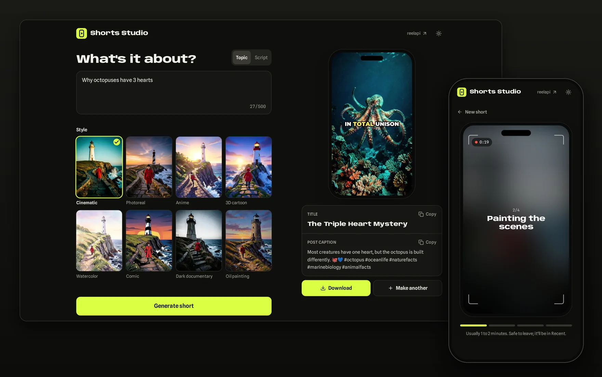

# Shorts Studio

Type a topic, get a finished short: script, AI images, voiceover, word-by-word captions and music from one [reelapi](https://reelapi.bitgate.dev) call.

[](https://deploy.workers.cloudflare.com/?url=https://github.com/bitgate/shorts-studio)



## Run it

1. Get a reelapi key (`rk_live_...`) at [reelapi.bitgate.dev](https://reelapi.bitgate.dev).
2. `cp .dev.vars.example .dev.vars` and paste the key in.
3. `pnpm install && pnpm dev`, then open http://localhost:5173. Ship it with `pnpm run deploy`.

Needs Node 22+ and pnpm 10.

## Configuration

| Name | Kind | |
|---|---|---|
| `REELAPI_KEY` | secret, required | Your reelapi key |
| `ACCESS_CODE` | secret, optional | Visitors need this code before they can generate. Set it on any public deployment, since every short runs on your key |
| `REELAPI_BASE_URL` | var | Defaults to `https://reelapi.bitgate.dev` |

Locally they live in `.dev.vars`. On Cloudflare: `pnpm wrangler secret put REELAPI_KEY`.

## How it works

The key stays on the Worker. The browser only talks to two routes:

- `POST /api/shorts` validates the form and starts a job with `POST /v1/shorts?wait=0`
- `GET /api/jobs/:id` returns the job; the UI polls it and follows `job.stage` until the video is ready

[`src/lib/reelapi.ts`](src/lib/reelapi.ts) is a zero-dependency typed client for every reelapi call (shorts, slideshow, captions, ffmpeg, uploads, jobs, webhook verification). Copy it into any TypeScript backend:

```ts
import { ReelApi } from "./reelapi";

const reel = new ReelApi({ apiKey: process.env.REELAPI_KEY! });

const job = await reel.createShort({ topic: "Why octopuses have 3 hearts", style: "anime" }, { wait: 0 });
const short = await reel.waitForJob(job);

console.log(short.outputs.video, short.result?.title);
```

## Coding agents

[`AGENTS.md`](AGENTS.md), [`CLAUDE.md`](CLAUDE.md) and [`.cursor/rules/reelapi.mdc`](.cursor/rules/reelapi.mdc) teach Claude Code, Cursor, Codex and friends the whole reelapi API, so "add a captions step" or "cut a vertical version of this clip" goes through reelapi instead of a local ffmpeg install.

## License

[MIT](LICENSE)
